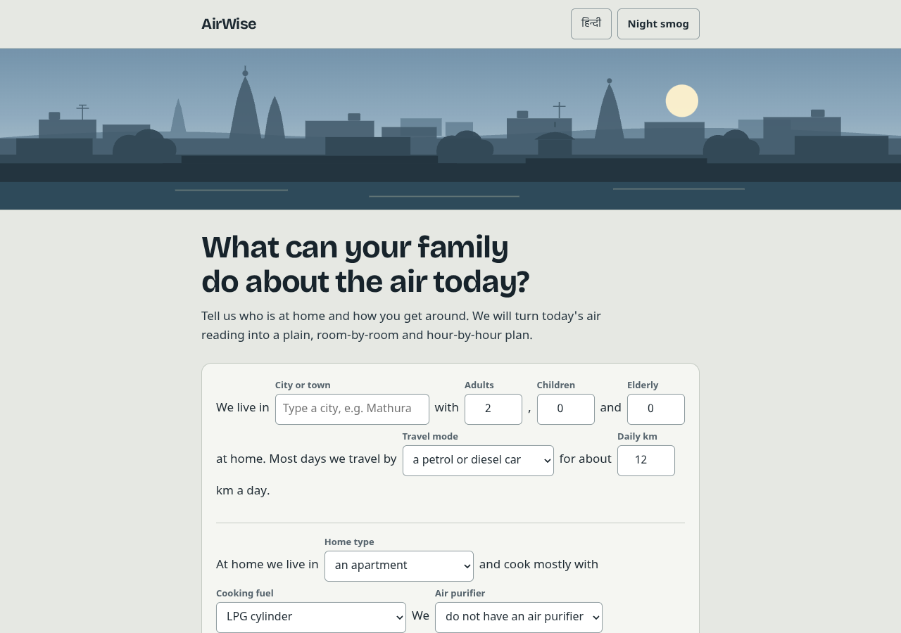
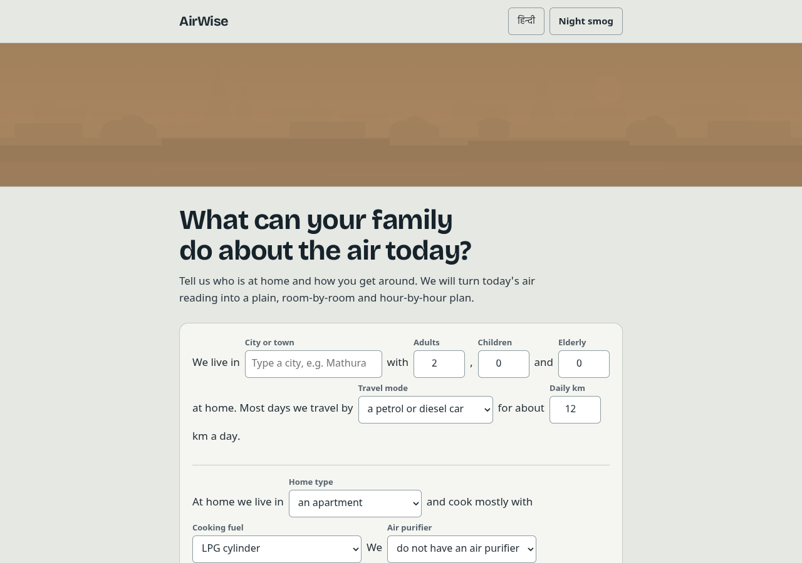
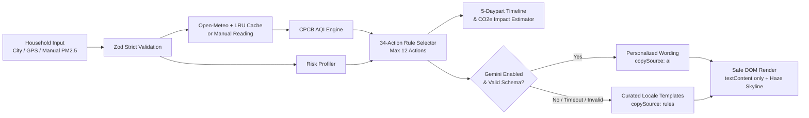

# AirWise

**AirWise** is a bilingual (English and Hindi) urban air-quality assistant built for North Indian families, schools, and Resident Welfare Associations (RWAs) navigating winter smog. Instead of dumping raw pollutant tables, AirWise combines live CPCB AQI readings (or a manual home/station PM2.5 reading) with a household's daily routine to deliver a calm, hour-by-hour, room-by-room plan—powered by a deterministic rule engine and optionally personalized by Google Gemini with silent rule-based fallback.

| Good air (`PM2.5 = 20 µg/m³`, CPCB AQI 33)                      | Severe smog (`PM2.5 = 300 µg/m³`, CPCB AQI 439)                     |
| --------------------------------------------------------------- | ------------------------------------------------------------------- |
|  |  |

---

## 2. Chosen Vertical & Persona

- **Persona**: **North Indian urban & peri-urban families** (Delhi NCR, Mathura, Agra, Noida, Gurugram, Lucknow, Kanpur, Varanasi) alongside **apartment RWAs and school notice-board coordinators** during October–January winter temperature inversions.
- **Why this persona**: During North Indian winter smog, families face urgent, recurring everyday choices every morning and evening—_Should we skip the 6 am walk? When is it safest to air out bedrooms? What can we do on a tight budget without a ₹15,000 purifier? How can our colony cut local dust and open burning?_ Most air apps show an alarming number and stop there. AirWise translates that reading into practical, budget-aware actions in plain English and natural spoken Hindi, plus a one-page printable notice-board sheet for apartment lifts and colony WhatsApp groups.

---

## 3. Problem & Requirement → Feature Mapping

| Requirement / Real-World Need                                                           | AirWise Feature                                                                                                                       | Implementation                                                                                 |
| --------------------------------------------------------------------------------------- | ------------------------------------------------------------------------------------------------------------------------------------- | ---------------------------------------------------------------------------------------------- |
| Accurate local severity using India's official scale                                    | India **CPCB National AQI** calculator (PM2.5 & PM10 linear sub-indices, 6 bands)                                                     | `src/config/aqiBreakpoints.js`, `src/engine/aqi.js`                                            |
| Works anywhere in India, even without external API keys or when feeds fail              | **Open-Meteo** geocoding & air-quality lookup + **manual PM2.5/PM10 entry** + opt-in browser geolocation                              | `src/services/airQualityService.js`, `public/js/combobox.js`, `public/js/geolocation.js`       |
| Tailored to children, older adults, breathing/heart conditions, budget, fuel & purifier | **Household risk profiler** (`standard`, `elevated`, `high`) & **34-action rule selector** (capped at 12 balanced actions)            | `src/engine/riskProfile.js`, `src/knowledge/actions.js`, `src/engine/actionSelector.js`        |
| Practical hour-by-hour timing around winter inversions                                  | **5-stop daily timeline** (`Early morning` → `Night`) using hourly lowest-PM2.5 window or North Indian winter pattern                 | `src/engine/timeSlots.js`, `public/js/render.js`, `public/js/renderIcons.js`                   |
| Realistic, honest sustainable switches                                                  | **Transparent commute CO₂e comparison table** with expandable _"How we worked this out"_ formula & assumptions                        | `src/config/emissionFactors.js`, `src/engine/impact.js`                                        |
| Warm, context-aware phrasing without AI hallucinations                                  | **Constrained Google Gemini personalization** strictly bound to engine-selected `actionId`s, Zod-validated, with silent rule fallback | `src/services/geminiService.js`, `src/services/geminiSchema.js`, `src/services/planBuilder.js` |
| Collective neighbourhood action                                                         | **RWA/colony actions**, **one-page print notice-board stylesheet**, and Web Share / clipboard summary                                 | `public/css/styles.css` (`@media print`), `public/js/main.js`                                  |
| Inclusive access across languages, devices, and abilities                               | **English + natural Hindi** (`en.json`, `hi.json`), **Light ("Haze Paper") & Dark ("Night Smog")** themes, WCAG 2.1 AA                | `public/locales/*`, `public/js/i18n.js`, `public/js/a11y.js`                                   |

---

## 4. Approach & Decision Logic

AirWise uses a **hybrid deterministic + constrained GenAI** architecture:

1. **Deterministic Engine Decides What To Do**:
   - Computes India CPCB AQI (`max(subIndex(PM2.5), subIndex(PM10))`).
   - Evaluates household vulnerability (`standard`, `elevated`, `high`).
   - Filters and scores 34 curated actions across 4 categories (`daily_routine`, `indoor_air`, `sustainable_alternative`, `community`), enforcing budget, cooking-fuel, purifier, commute, and sensitivity rules, capped at 12 actions.
   - Assigns actions to 5 North Indian dayparts and estimates commute CO₂e savings transparently.
2. **Constrained GenAI Decides How To Phrase It (Optional)**:
   - Sends only coarse enums (`aqiCategory`, `dominantPollutant`, `vulnerabilityLevel`, `language`) and the engine's selected `actionId`s to `@google/genai` (zero PII, zero raw user free text).
   - Validates output against a strict Zod schema enforcing exact `actionId` parity and character limits, strips any markup, and silently falls back to curated locale templates (`copySource: "rules"`) on missing keys, timeouts, API errors, or validation failures.



---

## 5. How It Works Step-by-Step

1. The user enters a city (debounced `/api/geocode`), uses opt-in geolocation, or opens manual PM2.5/PM10 entry, then completes two plain-language household sentences and submits.
2. `POST /api/plan` validates the JSON body with Zod `.strict()` (rejecting unknown keys and out-of-range numbers).
3. The server fetches cached/live Open-Meteo data (or uses manual PM2.5/PM10), computes CPCB AQI, scores household risk, selects up to 12 actions, builds the 5-daypart timeline, computes commute CO₂e savings, and optionally personalizes copy via Gemini.
4. The frontend transitions the 5-layer riverfront haze skyline via `hero[data-band]` and renders the plan safely with `textContent` only.

### Sample Request (`POST /api/plan`)

```json
{
  "manual": { "pm25": 300, "label": "Anand Vihar, Delhi" },
  "profile": {
    "members": { "adults": 2, "children": 1, "elderly": 0 },
    "hasRespiratoryOrHeartCondition": false,
    "commute": "car",
    "commuteKmPerDay": 18,
    "cookingFuel": "lpg",
    "hasPurifier": false,
    "budget": "medium",
    "homeType": "apartment",
    "language": "en"
  }
}
```

### Sample Response (abbreviated)

```json
{
  "aqi": {
    "aqi": 439,
    "category": "Severe",
    "band": "severe",
    "dominantPollutant": "PM2.5",
    "pm25": 300,
    "pm10": null,
    "dataSource": "manual",
    "placeLabel": "Anand Vihar, Delhi"
  },
  "risk": {
    "vulnerabilityLevel": "high",
    "isSensitiveGroup": true
  },
  "plan": {
    "copySource": "rules",
    "headline": "Severe smog today; stay indoors and protect sensitive family members",
    "items": [
      {
        "id": "seek_medical_care_if_symptoms",
        "category": "daily_routine",
        "daypart": "any",
        "cost": "free",
        "effort": "easy",
        "text": "Keep prescribed inhalers or medicines handy, and seek medical care promptly if anyone develops wheezing, breathlessness, or chest tightness."
      }
    ],
    "commuteImpact": {
      "currentLabel": "Petrol car",
      "newLabel": "Metro rail",
      "kmPerDay": 18,
      "dailyKgCO2Saved": 2.52,
      "monthlyKgCO2Saved": 55.44
    },
    "bestHours": {
      "windowSource": "pattern",
      "windowLabel": "13:00 - 16:00",
      "isPattern": true
    }
  }
}
```

---

## 6. Setup

1. **Prerequisites**: Install **Node.js 20+** (tested on Node 22).
2. **Install dependencies**:
   ```bash
   npm install
   ```
3. **Create your environment file**:
   ```bash
   cp .env.example .env
   ```
4. **Configure Gemini (optional — app runs cleanly without it)**: Open [Google AI Studio](https://aistudio.google.com/apikey), create an API key, paste it into `GEMINI_API_KEY` in `.env`, and verify `GEMINI_MODEL` matches a currently available Gemini model in your account (default: `gemini-4-hydrogen`). Leave `GEMINI_API_KEY` blank to run in deterministic rule-based mode.
5. **Run the app & test suite**:
   ```bash
   npm start        # Opens on http://localhost:3000
   npm test         # Runs all unit, integration, a11y, and hygiene tests
   ```

---

## 7. Security Measures

- **Strict Content Security Policy (Helmet)**: `default-src 'self'`, `script-src 'self'`, `style-src 'self'`, `font-src 'self'`, `img-src 'self' data:`, `connect-src 'self'`, `object-src 'none'`, `base-uri 'self'`, `form-action 'self'`. Zero inline scripts, zero inline styles, zero external CDNs.
- **No XSS Sink**: Frontend DOM rendering (`public/js/*`) uses `document.createElement` and `textContent` exclusively (enforced by automated tests; zero `.innerHTML`). Server strips any HTML tags from AI text.
- **Input Validation & Body Limits**: All endpoints validate inputs via strict Zod schemas (`.strict()` rejects unknown fields); JSON payload capped at `10kb`; `x-powered-by` disabled.
- **Origin Protection & Proxy Hygiene**: `originGuard` permits missing `Origin` (same-origin GET/curl), matching `Host` header, the first `X-Forwarded-Host` entry (only when `TRUST_PROXY` is active), configured `ALLOWED_ORIGINS` (comma-separated, trimmed, trailing slashes removed), and in non-production (`NODE_ENV !== "production"`) any `http://localhost` or `http://127.0.0.1` origin on any port. Rejected origins log a single warning containing only `Origin`, `Host`, and `X-Forwarded-Host` and return `403` (`ORIGIN_NOT_ALLOWED`). `TRUST_PROXY` defaults to `1` on Cloud Run / AI Studio preview and `false` locally; it accepts `false`, non-negative integer hop counts, or IPv4/IPv6 CIDR range(s), and rejects `"true"`.
- **Rate Limiting**: Global limiter (`100 req / 15 min` default) plus stricter `/api/plan` limiter (`33 req / 15 min` default) via `express-rate-limit`, forwarding `429 RATE_LIMITED` errors through the centralized `errorHandler` so responses include `requestId`.
- **Prompt-Injection & PII Defense**: Gemini receives zero user free-text strings, coordinates, or health flags—only coarse category enums and engine `actionId`s—and system instructions treat all payload fields strictly as untrusted data.
- **Error Handling & Audit**: Centralized error handler returns structured `{ error: { code, message, requestId } }` with no stack traces; `npm audit --omit=dev` reports **0 vulnerabilities** across runtime dependencies.

---

## 8. Accessibility Measures (WCAG 2.1 AA)

- **Zero axe-core violations**: Automated `axe-core` + `jsdom` checks pass with 0 violations on both the initial landing state and rendered plan results.
- **Semantic Landmarks & Keyboard Flow**: Skip-to-main link, single `<h1>` with proper heading hierarchy, visible `3px` `:focus-visible` outlines, full keyboard operation (city combobox ArrowUp/Down/Enter/Escape, expandable _"Show why"_ and _"How we worked this out"_ panels with `aria-expanded` & `aria-controls`).
- **Accessible Errors & Live Announcements**: Validation renders a focus-managed error summary linking directly to invalid fields (`aria-invalid="true"`), and a polite `aria-live="polite"` region announces loading, ready, error, and language-switch states.
- **Never Colour Alone**: Every CPCB AQI band pairs colour with a distinct geometric shape icon (circle, diamond, triangle, hexagon, octagon, square-cross) and explicit band text.
- **Bilingual & Inclusive Typography**: Toggle between English and natural spoken Hindi (`html[lang="en"|"hi"]`), generous `1.72` line-height for Devanagari, `44×44px` minimum touch targets, Light/Dark themes respecting `prefers-color-scheme`, and `prefers-reduced-motion` disabling the 1.2s haze transition.

---

## 9. Design Decisions

Full rationale is documented in [`docs/design.md`](docs/design.md). Key choices:

- **One Signature Visual Moment**: A hand-authored 5-layer inline SVG skyline of a North Indian riverfront town (ghats, shikhara spires, rooftops with water tanks, dusk sun) that visually shifts from crisp slate-blue (`Good`) to thick ochre inversion haze (`Severe`) purely via CSS custom properties on `data-band`.
- **Two Conversational Sentences Instead of a Form Grid**: Household details are entered inline in natural English or Hindi grammar so a worried parent never faces a bureaucratic spreadsheet.
- **Calm Editorial Hierarchy**: Cool grey-green "Haze Paper" (`#E6E8E3`) light ground and deep "Night Smog" (`#121B21`) dark ground, hairline dividers, zero pill clutter, zero card grids, and a one-page print layout formatted for apartment notice boards.

---

## 10. Efficiency Decisions

- **Minimal Dependency Footprint**: Only **6 runtime dependencies** (`express`, `helmet`, `express-rate-limit`, `zod`, `@google/genai`, `dotenv`) — zero frontend frameworks or bundlers.
- **Tiny Client Payload** (measured and enforced by automated tests):
  - CSS (`public/css/styles.css`): **26.8 KB** (budget < 30 KB)
  - JavaScript (`public/js/*.js` total): **39.8 KB** (budget < 60 KB)
  - Self-hosted subsetted woff2 fonts (Latin + Devanagari): **127.1 KB** (budget < 150 KB)
  - Inline skyline SVG: **5.8 KB** (budget < 12 KB)
- **Bounded Caching**: In-memory LRU+TTL cache (`10 min` default for air quality keyed by `0.01°`-rounded coordinates, ~1.1 km; `30 min` / `3×` TTL for geocoding; max `200` entries each) prevents redundant upstream fetches.
- **Token-Lean AI Calls & Strict Timeouts**: Compact JSON-only Gemini prompts with `ThinkingLevel.MINIMAL` on Gemini 4, 5 s upstream Open-Meteo timeout, and 12 s Gemini timeout with non-retryable 4xx fast fallback.

---

## 11. Testing

Run all tests or check coverage:

```bash
npm test
npm run test:coverage
npm run lint
```

### What Is Covered (12 Suites · 122 Tests)

- **Unit tests** (`tests/unit/`): CPCB AQI boundary breakpoints & dominant pollutant (`aqi.test.js`), household risk scoring (`riskProfile.test.js`), 34-action rule filtering & caps (`actionSelector.test.js`), daypart timeline & best-hour detection (`timeSlots.test.js`), transparent CO₂e impact math (`impact.test.js`), LRU/TTL cache (`cache.test.js`), Open-Meteo parsing & timeouts (`airQualityService.test.js`), Gemini schema validation, markup stripping, prompt-injection isolation, and fallback (`geminiService.test.js`), frontend error mapping, locale parity, strict CSP/budget checks, `public/` allowlist, and git secret scan (`frontendAndHygiene.test.js`).
- **Integration tests** (`tests/integration/`): Supertest API route suite (`api.test.js` covering `/api/health`, `/api/geocode`, `/api/air`, `/api/plan`, Gemini 403 fallback, upstream failure fallback, unknown-key/range rejection) and dedicated security suite (`security.test.js` covering CSP headers, `413` body cap, `403 ORIGIN_NOT_ALLOWED` origin guard, `TRUST_PROXY` validation, and `429` rate limit with `requestId`), sharing `testApp.js`.
- **Accessibility tests** (`tests/a11y/a11y.test.js`): `axe-core` + `jsdom` zero-violation checks on initial & rendered results states, label association, bilingual `html[lang]`, live region announcements, and 6-band skyline state transitions.
- **Lint & formatting** (`npm run lint`): runs `eslint . && prettier --check .`, including a custom ESLint rule requiring JSDoc (`@param`/`@returns`) on all exported functions in `src/` and `public/js/`.

### Actual Jest Coverage (`npm run test:coverage`)

Coverage scope (`collectCoverageFrom`): `src/engine/**/*.js`, `src/services/**/*.js`, `src/utils/**/*.js`.

| File / Directory |    % Stmts |   % Branch |    % Funcs |    % Lines |
| ---------------- | ---------: | ---------: | ---------: | ---------: |
| **All files**    | **94.44%** | **83.19%** | **95.29%** | **94.96%** |
| `src/engine`     | **94.93%** | **89.17%** | **96.66%** | **95.57%** |
| `src/services`   | **96.44%** | **76.96%** | **97.56%** | **97.23%** |
| `src/utils`      | **87.14%** | **73.77%** | **85.71%** | **87.14%** |

---

## 12. Assumptions and Limitations

- **Hourly vs. 24-Hour CPCB Approximation**: Official CPCB AQI is defined over 24-hour rolling averages for PM2.5/PM10; live feeds and manual spot readings reflect current/hourly values, so computed AQI is an honest real-time approximation.
- **Modelled vs. Ground Station Data**: Open-Meteo provides atmospheric model estimates (~10–11 km resolution), which can differ from hyper-local roadside CPCB monitors. Families can override with a nearby ground station or home monitor via manual entry.
- **Approximate Emission Factors**: Commute CO₂e savings use approximate Indian urban transport averages (22 commute days/month) and vary with vehicle age, fuel type, congestion, and occupancy.
- **Winter Inversion Pattern vs. Local Forecast**: When hourly PM2.5 data is unavailable (such as manual entry), daypart advice follows the general North Indian winter inversion pattern (heaviest smog at dawn/night, lighter midday) rather than a site-specific meteorological forecast.
- **Not Medical Advice**: AirWise provides practical, cautious ("can help reduce") air-quality guidance and is not a substitute for professional medical diagnosis or emergency care.

---

## 13. Project Structure

```text
airwise/
├── docs/
│   ├── architecture.md          # System architecture & Mermaid data-flow diagram
│   ├── decisions.md             # Engineering & design decision log
│   ├── design.md                # Visual system, palette, typography & layout spec
│   └── images/                  # Compressed Good & Severe haze screenshots
├── public/
│   ├── css/styles.css           # Haze Paper / Night Smog tokens, skyline haze, print sheet
│   ├── fonts/                   # Self-hosted subsetted Bricolage Grotesque & Hind + OFL licences
│   ├── js/                      # Vanilla ES modules (main, combobox, geolocation, form, api, render, renderIcons, haze, i18n, a11y)
│   ├── locales/                 # Key-identical en.json & hi.json translations
│   └── index.html               # Semantic HTML + 5-layer riverfront SVG skyline
├── src/
│   ├── config/                  # Env validation, CPCB breakpoints, emission factors
│   ├── engine/                  # Pure deterministic AQI, risk, selector, timeline & impact modules
│   ├── knowledge/               # 34 curated North Indian actions & locale loader
│   ├── middleware/              # Helmet CSP, origin guard, rate limits, Zod validators, error handler
│   ├── routes/                  # /api/health, /api/geocode, /api/air, /api/plan
│   ├── services/                # Open-Meteo client, Gemini client & schema/sanitizer, plan orchestrator
│   ├── utils/                   # Structured PII-free logger, typed AppErrors, LRU+TTL cache
│   ├── app.js                   # Express app factory (testable via Supertest)
│   └── server.js                # HTTP server entry point & graceful shutdown
├── tests/
│   ├── a11y/                    # axe-core + jsdom WCAG 2.1 AA tests
│   ├── integration/             # Supertest API routes (api.test.js), security (security.test.js) & testApp.js
│   └── unit/                    # Engine, service, frontend & secret-hygiene tests
├── .env.example                 # Safe configuration template (no secrets)
├── .gitignore                   # Ignored local, build, and runtime artifact paths
├── .prettierignore              # Files excluded from Prettier checks
├── .prettierrc                  # Prettier formatting rules
├── eslint.config.js             # ESLint v10 flat config + export JSDoc rule
├── LICENSE                      # MIT License
├── metadata.json                # Applet runtime manifest
├── package.json                 # ESM scripts & minimal dependency manifest
├── package-lock.json            # Deterministic dependency lockfile
└── README.md                    # Setup, architecture, security & testing guide
```

---

## 14. Future Work

- **Direct Ground-Station CPCB / Sameer Integration**: Blend official ground monitoring station readings alongside Open-Meteo when available for hyper-local street accuracy.
- **Offline Progressive Web App (PWA) & SMS/WhatsApp Digest**: Cache the last generated household plan and rule engine for intermittent connectivity and shareable daily morning summaries.
- **Additional Regional Languages**: Extend the key-parity locale architecture (`public/locales/`) to Punjabi, Urdu, and Bengali for wider Indo-Gangetic Plain coverage.
- **School & RWA Multi-Household Coordinator Mode**: Generate tailored GRAP Stage I–IV school recess and colony construction-dust checklists from a single reading.
