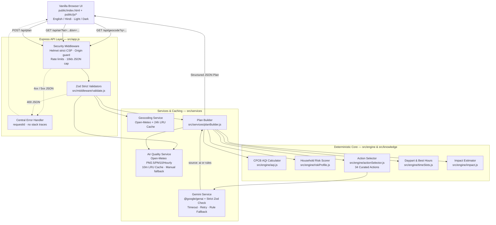

# AirWise Architecture

AirWise is a hybrid **deterministic rule engine + constrained GenAI** web application built on Node.js 20+ (ES modules), Express, and vanilla HTML/CSS/JS. Its core design goal is safety and reliability: **every health, indoor-air, sustainable-switch, and community recommendation is chosen by a unit-tested rule engine from a curated 34-action knowledge base.** Google Gemini is used strictly as an optional language personalization layer over those exact selected action IDs, with strict Zod validation and silent deterministic fallback.

---

## 1. High-Level Request & Data Flow

---

## 2. Module Responsibilities

| Layer | Path | Responsibility |
|---|---|---|
| **Config** | `src/config/index.js` | Loads and validates `.env` via Zod; detects missing/placeholder `GEMINI_API_KEY` and safely degrades to rule-based mode without crashing. |
| **Domain Tables** | `src/config/aqiBreakpoints.js`, `src/config/emissionFactors.js` | Official India CPCB National AQI breakpoints (PM2.5 & PM10) and transparent Indian urban transport CO₂e emission factors. |
| **Core Engine** | `src/engine/aqi.js` | Computes linear sub-indices for PM2.5 and PM10, takes `max(subIndex)`, classifies into 6 CPCB bands (`Good` through `Severe`), and maps to CSS band slugs. |
| **Core Engine** | `src/engine/riskProfile.js` | Classifies household vulnerability (`standard`, `elevated`, `high`) from children, elderly, respiratory/heart flag, and commute exposure. Never logs health flags. |
| **Knowledge Base** | `src/knowledge/actions.js`, `src/knowledge/localeLoader.js` | 34 curated North Indian actions across 4 categories (`daily_routine`, `indoor_air`, `sustainable_alternative`, `community`), with locale-keyed English & Hindi templates. |
| **Core Engine** | `src/engine/actionSelector.js` | Filters by AQI band, budget, cooking fuel, purifier ownership, commute mode, and sensitivity; guarantees balanced category coverage and caps at 12 actions. |
| **Core Engine** | `src/engine/timeSlots.js` | Maps actions into 5 North Indian winter dayparts (`early_morning`, `school_work_run`, `midday`, `evening`, `night`) and computes lowest-PM2.5 window from hourly data (or winter inversion fallback). |
| **Core Engine** | `src/engine/impact.js` | Calculates approximate daily and monthly CO₂e savings for cleaner commute switches, returning the exact formula and plain-English assumptions. |
| **External Services** | `src/services/airQualityService.js` | Fetches keyless Open-Meteo geocoding and air quality with 5-second `AbortController` timeouts, 0.05° coordinate rounding, and bounded LRU+TTL caching (`src/utils/cache.js`). |
| **GenAI Service** | `src/services/geminiService.js` | Sends a compact, PII-free JSON payload (`aqiCategory`, `dominantPollutant`, `vulnerabilityLevel`, `language`, and selected `actionId`s) to `@google/genai`, validates strict JSON schema + exact action ID parity + character caps, strips any HTML markup, and falls back silently to rule-based templates on any failure. |
| **API & Security** | `src/middleware/*`, `src/routes/*`, `src/app.js`, `src/server.js` | Helmet strict CSP, same-origin check (permitting missing `Origin`, matching `Host`, and `ALLOWED_ORIGINS`), global + `/api/plan` rate limits, 10 KB body limit, Zod `.strict()` validators, centralized error handler with `requestId`. |
| **Frontend** | `public/index.html`, `public/css/styles.css`, `public/js/*`, `public/locales/*` | Zero-build vanilla ES modules, self-hosted Latin + Devanagari woff2 fonts, 5-layer haze skyline SVG controlled solely via `data-band`, `textContent`-only DOM rendering, bilingual English/Hindi switcher, Light/Dark themes, one-page notice-board print stylesheet. |

---

## 3. Privacy & Prompt-Injection Boundary

1. **No database or server-side user storage**: Household profiles (including health sensitivity) exist only in memory for the duration of a single `POST /api/plan` request and are never written to disk or logged.
2. **PII-stripped AI prompt**: `buildCompactPromptPayload()` never forwards city free text, GPS coordinates, or `hasRespiratoryOrHeartCondition` to Gemini—only coarse enums (`aqiCategory`, `dominantPollutant`, `vulnerabilityLevel`, `language`) and the engine's selected `actionId` list.
3. **Output sandboxing**: Gemini cannot invent actions, omit required actions, exceed field length limits, or inject HTML (server strips tags with `stripMarkup()`, and the browser renders exclusively with `textContent`).
